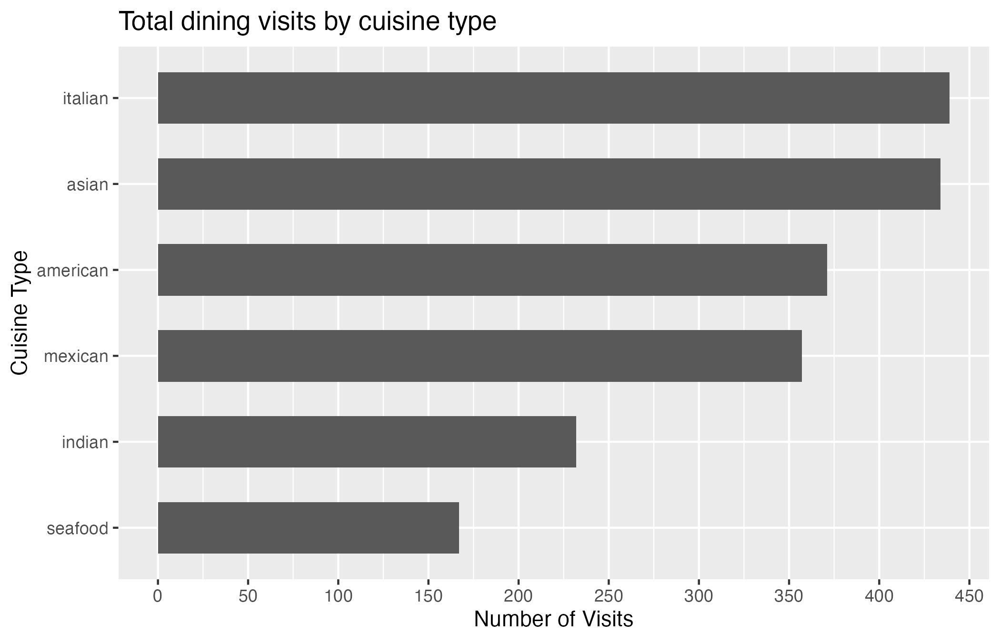
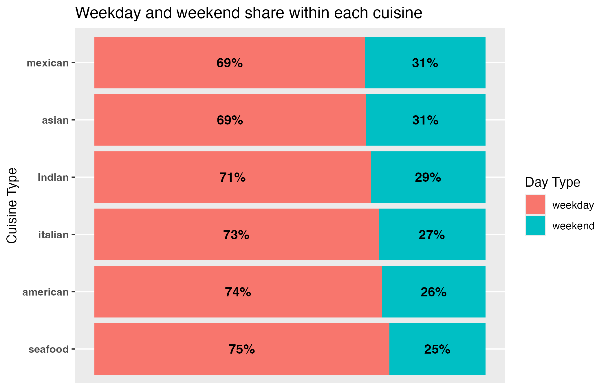

I wanted to see which cuisines appear most often in these 2,000 restaurant visits, then check whether the weekday and weekend mix changes by cuisine. The first chart counts visits. The second divides each cuisine's visits into weekday and weekend shares, so a cuisine with more visits does not automatically look like it has a bigger weekend share.

```{r}
#| label: setup
#| message: false
#| warning: false
#| include: false

library(here)
library(ggplot2)
source(here("pages", "project", "src", "functions", "save_plot_as_png.R"))
```

```{r}
#| label: read-data
#| message: false
#| warning: false
#| include: false

source(here("pages", "project", "src", "data", "restaurant_dining_cleaning.R"))
df <- readRDS(here("pages", "project", "data", "cleaned", "restaurant_dining_cleaned.Rds"))
```

## Which cuisines show up most?

```{r}
#| label: cuisine-counts
#| echo: false
#| message: false

p_count <- df |>
  dplyr::mutate(cuisine_type = forcats::fct_rev(forcats::fct_infreq(cuisine_type))) |>
  ggplot(mapping = aes(y = cuisine_type)) +
  geom_bar(width = 0.6) +
  scale_x_continuous(breaks = scales::breaks_width(50)) +
  labs(
    title = "Total dining visits by cuisine type",
    x = "Number of Visits",
    y = "Cuisine Type"
  )

save_plot_as_png(
  user_name = "project",
  file_name = "restaurant_cuisine_counts.png",
  plot = p_count,
  width = 7,
  height = 4.5,
  units = "in",
  dpi = 300
)
```

{width=80%}

Italian has 439 visits and Asian has 434, nearly tied at the top. Seafood has 167, the fewest in this file. This tells me how the recorded visits are distributed, but not why people chose a cuisine.

## Does the weekend share change?

```{r}
#| label: weekend-share
#| echo: false
#| message: false

p_percent <- df |>
  dplyr::count(cuisine_type, day_type) |>
  dplyr::mutate(pct = n / sum(n), .by = cuisine_type) |>
  dplyr::mutate(
    weekend_share = sum(pct[day_type == "weekend"]),
    .by = cuisine_type
  ) |>
  dplyr::mutate(
    cuisine_type = forcats::fct_reorder(cuisine_type, weekend_share),
    day_type = factor(day_type, levels = c("weekday", "weekend"))
  ) |>
  ggplot(mapping = aes(x = pct, y = cuisine_type, fill = day_type)) +
  geom_col(position = position_stack(reverse = TRUE)) +
  geom_text(
    mapping = aes(label = scales::percent(x = pct, accuracy = 1)),
    position = position_stack(vjust = 0.5, reverse = TRUE),
    fontface = "bold"
  ) +
  scale_x_continuous(name = NULL, breaks = NULL) +
  theme(axis.text.y = element_text(face = "bold")) +
  labs(
    title = "Weekday and weekend share within each cuisine",
    y = "Cuisine Type",
    fill = "Day Type"
  )

save_plot_as_png(
  user_name = "project",
  file_name = "restaurant_weekend_share.png",
  plot = p_percent,
  width = 7,
  height = 4.5,
  units = "in",
  dpi = 300
)
```

{width=80%}

Weekdays account for most visits in every cuisine. Mexican and Asian have the largest weekend shares at about 31% each, while seafood has the smallest at about 25%. I sorted the bars by weekend share to make that comparison easier to see.

These percentages are shares of the visits in this dataset. They do not adjust for the number of weekdays and weekend days, so I would not use them alone to say when people are more likely to dine out.

I cleaned the category labels by trimming spaces and using lowercase spelling, then set weekday before weekend for a consistent order. The cleaning step kept all 2,000 rows.
